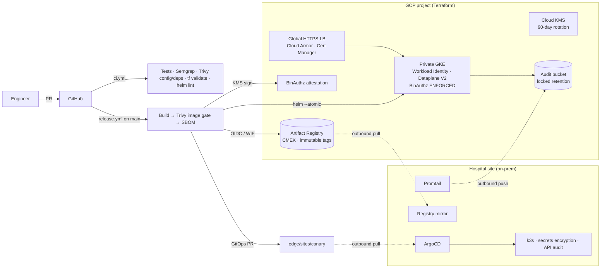

# Architecture

## Request path (cloud)
Client → Global external HTTPS LB (Cloud Armor WAF + rate limit, Google-managed
cert) → NEG → tray-tracker pods (non-root, read-only FS, NetworkPolicy).

## Request path (hospital)
Hospital LAN device → Traefik (k3s) → tray-tracker pod. No public exposure.

## Failure modes I designed for

| Failure | Behavior |
|---|---|
| Hospital WAN down | Pods keep running; restarts pull from local mirror; ArgoCD retries with backoff; logs buffer on disk |
| Bad release | `helm --atomic` rolls back on GKE; canary hospital catches it before the general wave; revert PR rolls edge back |
| Unscanned / unsigned image | Binary Authorization blocks it at admission on GKE |
| Leaked CI credential | No long-lived keys exist; WIF token is short-lived and pinned to one repo |
| Node compromise | Shielded VM + secure boot, no legacy metadata, Workload Identity limits blast radius |
